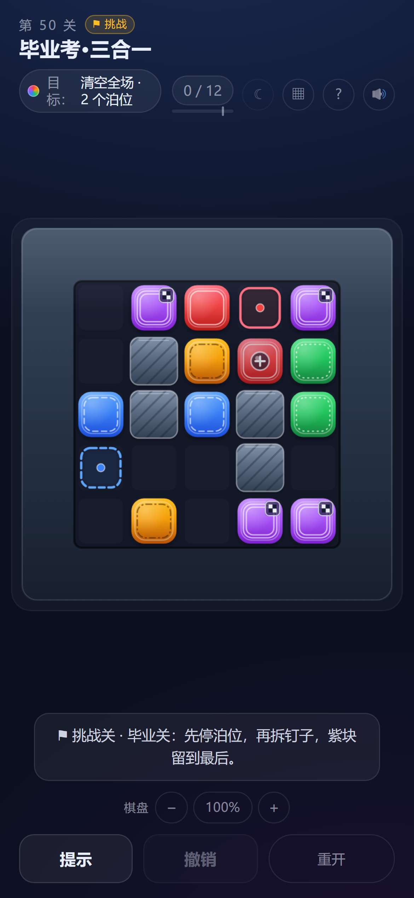

# 《撞个正着》设计思路文档

> H5 滑动解谜 · 固定 50 关 · v1.0
> 作品地址：https://asdzza.github.io/h5_game/
> 文档日期：2026-11-12

## 1. 作品信息

| 项目 | 内容 |
| --- | --- |
| 作品名称 | 《撞个正着》 |
| 类型 | 2D 滑动解谜 / 休闲益智 |
| 平台 | 浏览器 H5，横竖屏自适应，移动端优先 |
| 关卡 | 固定 50 关，5 个章节 |
| 单局时长 | 1–3 分钟 |
| 操作 | 拖拽 / 鼠标 / 键盘；支持读屏 |
| 目标 | 清空全场，或在指定关卡只清除目标颜色 |
| 技术 | 原生 HTML / CSS / JavaScript，Canvas 2D，无后端、无网络请求 |

## 2. 一句话与核心体验

> 拖住一个方块，松手后它会一直滑，直到撞上墙、边界或别的方块；撞上同色方块，两块一起消失。

这句话听起来像一款普通的滑块消除游戏，真正改变决策的是它的副作用：**消除会拆掉两块“刹车”**。方块停在别的方块前面，才能借它转向或停到指定位置；可一旦撞上去，两块都会消失，下一次就没有这个停靠点了。

于是每一步都在问同一个问题：

> 这块挡路的东西，我现在是**借它停车**，还是**把它消掉换一条路**？

这就是《撞个正着》的核心：规则只有一句话，但“什么时候消”比“消哪一对”更重要。游戏不靠连锁、重力、道具或数值成长制造难度，只靠空间关系与消除时机。

## 3. 设计目标

1. **规则一眼能懂。** 没有第二套操作，没有资源条，没有随机掉落。玩家松手前就能预测结果。
2. **每一步都在做选择。** 如果“看到同色就消”总能过关，关卡就是假的。每关都要让顺序、停靠点或目标取舍真正影响步数。
3. **所有关卡可被验证。** 用规则模拟器与 A\* 求解器算出 par、步数上限、死局和“无脑解”，不靠手感拍脑袋。
4. **低门槛，高上限。** 触屏、鼠标、键盘、读屏都能玩；色弱玩家有线条辅助；看不清可以缩放；卡关有分层提示与最优解回放。

## 4. 方案选型：为什么是“碰碰消”

开发前比较了三个候选：

| 方案 | 一句话 | 加权得分 | 结论 |
| --- | --- | ---: | --- |
| **A 碰碰消** | 拖一个方块滑到底，撞上同色一起消失 | **86** | 采用，定名《撞个正着》 |
| B 同色齐动 | 选一种颜色和方向，该色所有方块一起滑 | 62 | 有深度但输入绕、单步认知负荷高，放弃 |
| C 重力轮盘 | 消一对相邻同色，再让重力转 90° | 50 | 选择多但结果不可控，放弃 |

选择 A 的三个硬理由：

- **规则最少。** 完整规则只有四条：滑动、遇墙停、遇异色停、遇同色消。玩家可以“一眼预测”。
- **微创新落在决策上。** 消除只移除、不新增，所以每消一对等于拆掉两堵墙；“借它停车还是消它开路”是可验证的真实选择。
- **可验证性最高。** A 的 13 个精选关卡都能秒级求出 par，能自动判定贪心策略是否失败、随机乱滑能否通关；B、C 在同样预算内无法保证 50 关质量。

## 5. 核心规则与三种“刹车”

### 5.1 基础规则

1. 棋盘为 7×7 网格，边缘与墙格不可进入。
2. 每格至多一个方块，方块有五种颜色。
3. 玩家按住方块，向上下左右拖动后松手。
4. 方块沿该方向逐格滑动，直到：
   - 下一格是墙或边界：停在最后一个空格；
   - 下一格是异色方块：停在它旁边，不推动它；
   - 下一格是同色方块：两块一起消失，移动块不占目标格。
5. 一次操作最多消一对，无连锁、无重力、无随机。
6. 步数用完仍未达成目标即失败；撤销会退还步数。
7. 部分关卡目标不是清空，而是“只清除指定颜色”。

### 5.2 三种特殊机制

三种机制都只改变“什么算停对了”，不增加按键、不增加模式。

| 机制 | 盘面图示 | 规则 | 首次出现 |
| --- | --- | --- | --- |
| **锚块（钉子）** | 方块正中的深色钉帽 + 十字槽 | 自己拖不动；异色照常被它挡住；同色块撞上时两块一起消失 | #8「钉子户」 |
| **泊位** | 彩色虚线停车格 + 中心圆点 | 对应颜色停进去一次即永久打勾；通关要求所有泊位都停过 | #45「两段路」；#50 复用 |
| **最后一对** | 方块右上角的小方格旗 | 该色只剩两块时，必须是整盘最后一撞才能消 | #40「小结·最后一对」；#49 强化 |

- **锚块**把“刹车”从位置关系变成方块身份：它不能被挪开，只能绕开，再回来用同色撞掉。
- **泊位**把“停”变成必须命中的位置：不仅要清场，还要把指定颜色送进指定格。
- **最后一对**把“消”变成必须最后发生的动作：可以先把它当刹车挪来挪去，但不能提前消。

三种机制不是只在毕业关才出现：泊位先在 #45「两段路」单独教学，最后一对在 #49「最后一课」再练一次，到 #50 才三合一。这样玩家在 #50 需要同时处理三种约束时，已经分别见过每一种。三种机制在 #50 同场：红块先停进红泊位，才够得到被钉死的红锚块；蓝块借黄块停下，再进蓝泊位；紫块必须留到第 10 步最后一撞。毕业关的难点因此从“再省一步”变成“先停哪个、再拆哪个、哪个留到最后”。

## 6. 50 关结构

| 章节 | 关卡 | 新问题 | 里程碑 |
| --- | --- | --- | --- |
| S1 入门 | #1–#8 | 怎么停、怎么借块、怎么借墙 | #8 首次引入锚块 |
| S2 绕路 | #9–#18 | 墙从刹车变成路障，从哪绕 | #18 双锚块 Boss |
| S3 取舍 | #19–#30 | 哪些该消、哪些必须留 | #30 目标色本身被钉住 |
| S4 耦合 | #31–#40 | 一对解法的结果成为另一对的刹车 | #40 最后一对 |
| S5 精算 | #41–#50 | 上限压到 par+1 / par+2，顺序链条更长 | #45 泊位教学、#49 最后一对强化、#50 三合一 |

难度曲线不是简单“越来越多块”，而是每一章换一个问题：

- 第 1–3 关只教“滑动、停、同色消”，12 分钟内走完规则链。
- 第 4 关第一次改变目标：只清红，蓝块绿块永远消不掉，但必须被用上。
- 第 5 关目标色第一次变成两对，谁跟谁配由玩家自己决定。
- 第 6 关墙第一次把棋盘切开，玩家要选通道。
- 第 7 关停车点不再给定，要先“造”出来。
- 第 8 关锚块出现，刹车第一次不可移动。
- 第 9–18 关把“绕路”做成几何题，墙的缺口、回廊、窄门、假出口各换一种。
- 第 19–30 关用“目标切换”让非目标色变成必须保留的障碍和刹车。
- 第 31–40 关把多对颜色串成耦合链，一处停车影响下一处。
- 第 41–50 关收窄容错，#45 先教泊位、#49 再练最后一对，最后用三种“停法”做毕业考。

选关页默认开放全部 50 关（`?locked=1` 可恢复逐关解锁）：试玩时间有限的玩家可以直接查看后期关卡的机制组合；普通玩家按 1 → 50 顺序游玩，章节结构不变。

## 7. 关卡生产与验证

关卡不是手工拍脑袋定的。每关都走同一条产线：

1. **生成候选盘面。** 用脚本枚举颜色、墙位、目标与步数上限。
2. **求解 par。** 用 A\* 在规则模拟器上求最少步数，记录最优首步数量、最差首步、死局数量。
3. **过滤“假关卡”。** 如果贪心策略或随机乱滑也能在 par 内通关，说明顺序不重要，淘汰。
4. **检查承重。** 拆掉整组墙后 par 必须下降（泊位 / 最后一对关卡允许被机制锁住、par 不降）；如果关卡有非目标色，拿掉该整色后 par 必须变化。否则那块墙/那块颜色只是装饰。
5. **人工挑选。** 在满足硬指标的候选里，选择解法形态不同、读图更干净的盘面。
6. **写入游戏并回归。** 最优解写入 `src/solutions.js`，用游戏内核逐帧回放校验，再跑全量测试。

这套产线让“50 关”不是一个营销数字，而是 50 个可复算的关卡。最终 50 关全部可解，par 分布 2–10，步数上限只比 par 多 1–2 步；每一关都有最优解与失败判定。

## 8. 反馈、提示与可访问性

### 8.1 星级

- **3 星**：步数 ≤ par。
- **2 星**：步数 ≤ par + max(1, round((上限 − par) / 2))。
- **1 星**：在上限内通关。

提示会按使用次数扣星，但通关至少保留 1 星；扣星只在本次尝试内有效，重开或换关清零。这样提示是“救急”，不是“付费跳过”。HUD 的星级行与结算同口径：用了提示后立即显示本次还能拿到的星数（如「2★ ≤ N 步 · 提示扣 1★」），不显示拿不到的 3★。

### 8.2 卡关与失败

- **分层提示**：第一次只给当前盘面的策略提示；第二次指出一条可行路线；第三次打开完整解法（思路引言 + 按顺序的逐步走法，每步标明方块位置与结果）。每层都明确告知会扣星。
- **死局弱提示**：后台 Worker 只验证“按剩余步数是否还赢得了”，不提前剧透。确认无解才提示“撤销一步或重开”。
- **失败诊断与回退**：步数用完时列出“还差几对 / 几个泊位”，并从历史快照里找到“最后还能赢的一步”，一键退回那里，而不是从头再来。
- **撤销倒放**：撤销不仅退步数，还会把滑行与消除反向播放，让玩家看清刚才发生了什么。
- **最优解回放**：结算页可以看本关 par 解法的逐帧演示，不影响成绩、不写存档。

### 8.3 可访问性

- 五种颜色各配一种边缘线型，色弱玩家不靠颜色也能区分。
- 支持触屏、鼠标、键盘（方向键选块、空格拿起、方向键滑动、Esc 放下）。
- Canvas 有完整 `aria-label`，关键操作通过 `role="status"` 播报。
- 支持日间 / 夜间主题；提供 80%–200% 棋盘缩放，320px 窄屏可用。
- 不使用振动；动效可被 `prefers-reduced-motion` 降级。

## 9. 视觉与声音

- **视觉**：深色石板棋盘 + 五色渐变方块，方块边缘用不同线型做色弱辅助；锚块压暗并加钉帽，泊位用虚线停车格，最后一对用方格旗。
- **主题**：深色 / 浅色两套完整配色，墙、棋盘、HUD、弹窗一起切换。
- **声音**：WebAudio 合成音效，区分滑动、撞墙、消除、通关、UI；可一键静音。
- **反馈克制**：不做震屏和振动，靠滑行、挤压、撞击停顿、消除粒子和方向箭头表达结果。

> 图：第 50 关「毕业考·三合一」。红锚块（钉子）、红 / 蓝泊位（虚线停车格）与紫色「最后一对」（方格旗）在同一盘面互相牵制。

## 10. 范围与边界

这一版刻意不做：

- 不做每日挑战、不做额外模式、不做内购和广告。
- 不开放关卡编辑器，不引入随机生成。
- 不为了“看起来更大”把棋盘改成 8×8；50 关全部保持 7×7，难度来自问题类型而不是尺寸。

目标是把一个规则讲清楚、把 50 关做扎实、把移动端体验打磨到可以直接玩。范围越小，每一关的验证就越充分。

## 11. 结语

《撞个正着》想提供的不是“消掉很多块”的爽感，而是一个更安静的瞬间：你盯着盘面，发现那块一直用来刹车的方块，现在必须被消掉；或者你必须先把它送去一个泊位，再回来拆钉子。

一句话规则，三重刹车，50 个可验证的关卡。这就是这一版想交付的东西。